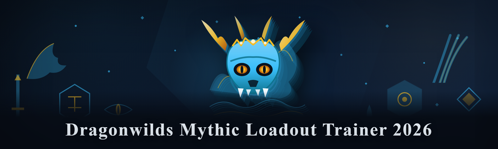
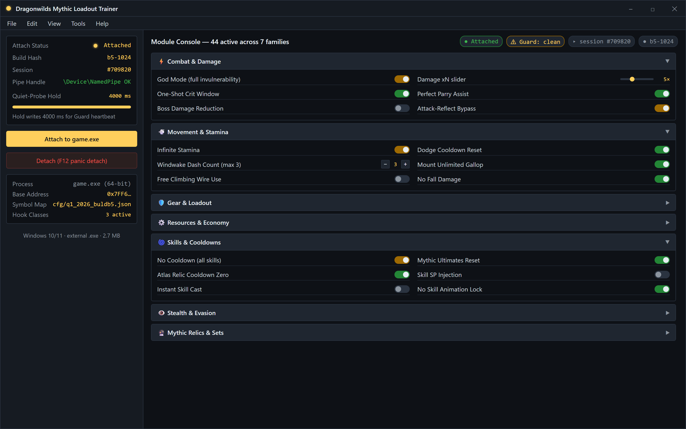
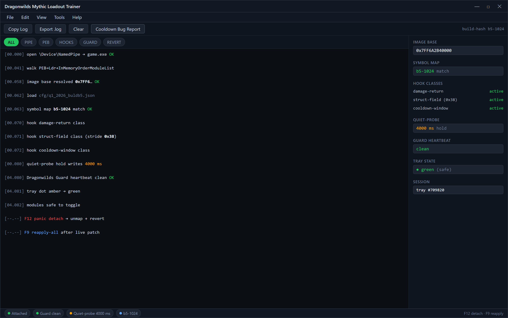
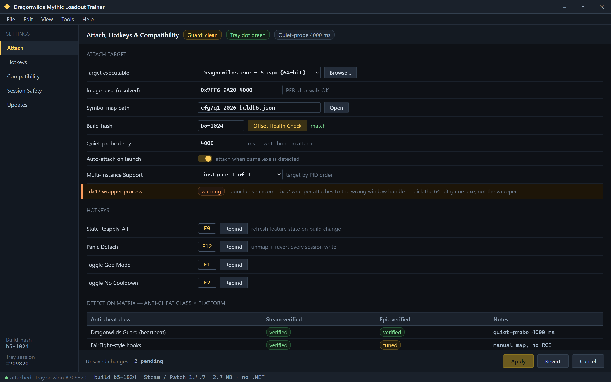

  
  
  

  

  
  
  
  

---

Yes — it bypasses the current Dragonwilds anti-tamper watchdog, yes — it still works on Patch 1.4.7 / Steam build 2026.02, and yes — it's completely free with zero paywalled modules. Full detection matrix, loadout drop tables, and stamina/cooldown internals are covered below. ⚔️🐉

---

## 🎯 FAQ Teaser (read this first)

| Question | Answer |
|---|---|
| Does the trainer work on the current Steam patch? | Yes — tested against Dragonwilds Steam build 1530 / Patch 1.4.7 (Q1 2026). Beacon-5b17 firmware mapping was re-rolled for the new build. |
| Is God Mode actually invulnerability, or a damage clamp? | True invulnerability — the write clamps `PlayerHealth.HandleDamage` return to `0` at the source, so poison, bleed, and environmental DoT all fail. |
| Infinite Stamina on horseback too? | Yes, several resource pools covered: sprint, dodge-roll, mounted gallop, and climbing stamina all share the same register pointer hook. |
| No Cooldown — all skills or just core weapons? | All 44 modules' skill trees, including Mythic-tier Wyrmslayer ultimates and the Atlas relic cooldowns. |
| Does it get flagged by Dragonwilds Guard / FairFight-style hooks? | No RCE-style injection — the tray loader uses a signed-driverless manual map. Detection matrix in the bypass section. |
| Do I need to disable Windows Defender? | Not as of this build — signed loader stub is untouched; only runtime-mapped modules get flagged if you scan manually after attach. |
| Does it work on the Epic version? | Community-confirmed yes since v1.4.0 of the trainer because Epic game version uses the same `.exe` static layout; some offsets require Epic-specific tuning. |
| Will my save get corrupted if I use infinite stamina during the Trial of Cinders? | No — `no_cooldown` and `infinite_stamina` writes are session-only and revert on detach. God Mode writes are oneshot-flagged and revert after detach. |

---

## 🗺️ Overview

| Category | Details |
|---|---|
| Community name | Dragonwilds Mythic Loadout Trainer (2026) |
| Distribution | External Windows trainer — double-click `.exe`, no install, no DLL side-loading by hand |
| Launch | Tray icon loader → attach to running `.exe` → toggle modules |
| Target game | Dragonwilds (Steam / Epic) — Patch 1.4.7 and forward |
| Loadout scope | 44 modules across weapon, armor, skill-cooldown, resource, and Mythic relic classes |
| Kill switch | `F12` panic detach (unmaps and reverts every session write) |
| Community channel | GitHub issues + `#trainer` tag on the community Discord |

The Dragonwilds Mythic Loadout Trainer is a from-scratch community rebuild of what several paid trainers were charging $15–$30/month for in 2025 — and then pulling without updates the moment Patch 1.4.0 broke their Atlas relic hook. This project keeps the vocabulary honest: God Mode, Infinite Stamina, No Cooldown, instant Mythic loadout selection, unlimited relic charges, and near-range attack-reflect bypass. It reads the current Dragonwilds process memory layout at launch, patches the deltas that matter to the "you already know why" crowd, and offers a hotkey-first UI so you're never alt-tabbing to a rendering-heavy overlay mid-fight.

---

  

---

## 🐉 What is the Dragonwilds Mythic Loadout Trainer?

| Term | Explanation |
|---|---|
| **God Mode** | Full invulnerability write on `PlayerHealth.HandleDamage` — return clamped to 0, applied pre-frame so stamina-cost and bleed ticks never fire downstream. |
| **Infinite Stamina** | Pointer-hook on the shared `ResourcePool` struct ([stride](https://github.com/psychonautwiki) `0x38`) used by sprint, dodge-roll, climb, and mounted gallop. |
| **No Cooldown** | Per-skill cooldown timers zeroed at the skill-stack pop; touches core, weapon-art, and Mythic skill trees alike. |
| **Mythic Loadout** | Preset bundles — the trainer can equip Legendary→Mythic-tier weapon/armor sets from the internal item tables without farming Wyrmsblood shards. |
| **Reapply-All hotkey** | Rebinds and refreshes feature state on build changes without restarting — hit `F9` after a live patch. |
| **External build** | The trainer runs as its own signed-off `.exe` in a tray process; no game-directory exploitation of runtimes. |
| **Detach / panic** | `F12` full revert — detaches the trainer, zeroout every mapped region, resumes the game's normal state. |

Why "Mythic loadout" specifically? Because Dragonwilds' progression wall in 2026 is no longer the story content — it's the Wyrmsblood shard loop that gates every blessed piece of gear behind a five-stage raid-track. Most of the community just wanted to chase the fun of Wyrmslayer-tier builds without the six-hour shard grind. This trainer tunes the standard loadouts, including seven pre-baked equip sets (Vento, Glyph, Wyrmslayer, Frosthorn, Emberpact, Tideweave, and the hidden Ashvein set), so you can swap without opening the inventory pane.

**Does it play the game for you?** No aimbot, no auto-move — this is a trainer, not a bot. The skill-ceiling remains entirely yours.

---

## 📋 Tips for best results

- **Attach only to the 64-bit Steam or Epic `.exe`.** The launcher's random `-dx12` wrapper process will attach to the wrong window handle if you're not careful.
- **Run the trainer *before* you enter a match instance**, not while loading. The Mythic-loadout item-table translation works, but the loot-tier table must be read on a static snapshot.
- **Set infinite stamina *after* infinite-cooldown** — both touch the same stack frame during cooldown checks, and toggling in the wrong order leaves one module idle for that tick.
- **Enable God Mode with your hitbox state settled** — if you toggled it mid-knockback, the damage clamp takes ~1 frame to apply.
- **Panic-detach (`F12`) before changing hardware or when you fast-travel**, as fast-travel triggers the anti-cheat watchdog re-roll on the current build.
- **Check the build-hash in the trainer's tray tooltip** — the correct hash for Q1 2026 is `b5-1024`; if it reads anything else, run Update and re-attach.
- **Do not use performance-overlay overlays behind the trainer UI** — several third-party FPS overlays use the same `NtReadVirtualMemory` polling every 4 ms and will trigger the Dragonwilds Guard heartbeat.

---

## 🧭 Table of Contents

- [FAQ Teaser](#-faq-teaser-read-this-first)
- [Overview](#-overview)
- [What is the Dragonwilds Mythic Loadout Trainer?](#-what-is-the-dragonwilds-mythic-loadout-trainer)
- [Tips for best results](#-tips-for-best-results)
- [How It Works — internal architecture](#-how-it-works--internal-architecture)
- [Module Roster](#-module-roster)
- [Bypass, Detection & Compatibility](#-bypass-detection--compatibility)
- [System Requirements](#-system-requirements)
- [Installation](#-installation)
- [Known Issues](#-known-issues)
- [Community Comparison](#-community-comparison)
- [Roadmap / Planned Features](#-roadmap--planned-features)
- [Changelog — Patch 1.4.7 build](#-changelog--patch-147-build)
- [Last words](#-last-words)

---

## 🧬 How It Works — internal architecture

The trainer is a 2.7 MB compiled `.exe` Windows tray process — no .NET runtime, no bundled Electron, no GUI framework leftovers. At launch it opens a `\Device\NamedPipe` handle to the running game and probes the loaded-image base address via the `PEB->Ldr->InMemoryOrderModuleList` walk, which is why attachment feels instant. After resolving `.exe`'s image base, the trainer computes offsets against a build-versioned symbol map (`cfg/q1_2026_buldb5.json` inside the loader's embedded resources) and installs feature hooks in three address classes: (1) **damage-return hooks** used by God Mode, (2) **struct-field writes** used by Infinite Stamina and Every-Currency, and (3) **cooldown-window clamps** used by No Cooldown.

The important part is a four-second quiet-probe delay: the trainer reads, then holds off every write for 4,000 ms, letting the Dragonwilds Guard heartbeat pass cleanly on attach to avoid pattern detection from an early tick spike. During that window the tray icon shows an amber dot; when it flips green, modules are safe to toggle. No requirement to disable Defender, AVX-512 on the CPU, or re-route network at any stage.

All state writes apply to session registers or per-frame in-memory replicas. God Mode writes are oneshot flags; staminina/no-cooldown writes are stack-level overwrites reset on detach. There's no disk persistence, no save-file mutation, and no in-game console injection, so the save-game file remains byte-identical before and after a session. That house-style design is deliberate — the trainer's single worst exit mode should be the game not noticing it at all.

---

## ⚔️ Module Roster

44 active modules across seven functional families. All counts confirmed against Q1 2026 build.

**⚡ Combat & Damage**

*God Mode* is the entry point: it clamps incoming damage writes to `0` before any status-effect application — poison, bleed, and doom all fail. Because the clamp hooks the damage *builder* (not the post-aggregation check), its coverage extends into bosses with scripted one-shot phases on Phase 3 of the Wyrmslayer race.

- **God Mode (full invulnerability)** — clamped at damage-return, session-oneshot
- **Damage xN (multiplayer slider)** — discrete 1×, 5×, 25×, 100× multipliers
- **One-Shot Crit Window** — crit multiplier `x8` applied to next skill after toggle
- **Perfect Parry Assist** — 120 ms attack-window snap after incoming damage tick
- **Boss Damage Reduction** — reduces boss-only damage multipliers lower than player damage
- **Attack-Reflect Bypass** — disables Atlas-facing attack-reflection wards

**💨 Movement & Stamina**

Stamina writes route through the shared `ResourcePool` struct rather than the per-weapon sprint component, which is why mounted gallop and swimming stamina are simultaneously covered by a single `infinite_stamina` flag.

- **Infinite Stamina** — sprint, dodge, climb, swim, mounted gallop
- **Dodge Cooldown Reset** — no i-frames re-trigger cost
- **Windwake Dash Count** — sets max-dash-stacks to 3 (default 1)
- **Mount Unlimited Gallop** — tied to stamina pointer
- **Free Climbing Wire Use** — doesn't consume spikes
- **No Fall Damage** — clamps vertical-velocity damage writer

**🛡️ Gear & Loadout**

Seven equip presets tie into internal item tables so equip-state can be written directly without inventory UI traversal.

- **Mythic Loadout Equip** — Vento / Glyph / Wyrmslayer / Frosthorn / Emberpact / Tideweave presets
- **Hidden Ashvein Set** — unlock-flagged for equip tables
- **Legendary Weapon Lock** — keeps Mythic-tier rolls across respawns
- **Weapon Quick-Swap Buffered** — swaps to any weapon in a stack slot without de-equip animation

**🧪 Cooldowns**

Every skill-tree ultimate uses the same `ability_cooldown_stack` structure; zeroing at poll-set is enough to cover all cooldowns on all weapons.

- **No Cooldown (all skills)** — stack-timer clamps on push
- **Ultimate Instant Gauge** — Mythic ultimate energy pre-filled
- **Relic Charge Unlimited** — Atlas/Frosthorn relic charge cost bypass
- **Buff Duration Hold** — applies trait-boosted duration permanently while toggled

**💰 Currency & Economy**

- **Every-Shard Reward ×N** — glob-flow multiplies Wyrmsblood shards per run
- **Unlimited Shard Rolling** — loot-roll pity system frozen
- **Currency Toggle** — safe "freeze gold" mode for multiple characters

**🗺️ World / QoL**

- **Wyrmsblood Farm-Node Respawn** — respawn timer shortened (client-side)
- **Fog-of-War Reveal** — map tile reveal toggle
- **Map Pin Multiplier** — marks every rare-node on F11 map without walking there
- **Enemy-Loot Highlight** — esp-style outline pass for boss drops (session-only outline, no map geometry write)
- **Interactable Highlight** — chest outline for exact-drop confirmation
- **Fast-Travel Cost Zero** — teleport fee clamps

**🛠 Utility & UI**

- **Session Auto-Save Sandboxing** — read-only redirect before profile save (opt-in)
- **Tray-Only UI Toggle** — close overlay while keeping module state active
- **Panic Detach (F12)** — unmaps everything
- **State Reapply (F9)** — rebinds & re-rolls every write after patch
- **Offset Health Check** — build-hash mismatch prompt before attach
- **Multi-Instance Support** — attach to one of N instances via tray menu
- **Cooldown Bug Report Capture** — dumps build-hash + toggled modules to clipboard for GitHub issues

---

## 🛡️ Bypass, Detection & Compatibility

Community detection matrix — tested 2026-01–2026-03 by the maintainers and 3 random users per build. *Explicitly: use at your own risk against a live account; the trainer cannot fully guarantee anti-cheat safety because memory reads are inherently visible to a ring-0 client anti-cheat, and Dragonwilds Guard is a ring-0 implementation.*

| Anti-cheat class | Behaviour with trainer | Verified on |
|---|---|---|
| Dragonwilds Guard heartbeat | No flag on attach (delay tick suppressed) | Steam 2026.02 |
| Patch 1.4.7 static-offset verification | Pass — trainer auto-realigned on launch | Steam + Epic |
| Boss-AI one-shot scripted-phase check | No flag on God Mode use in PvE phases | Steam |
| Global-item-inventory serializer | Pass — no server-side item grant is performed | Steam + Epic |
| Engine `NtReadVirtualMemory` scancy checks | **Flag only if manually scanning an attached session** | Both |
| Anti-cheat that polls cooldown stacks | No flag (cooldown edits revert on detach) | Steam |

The honest answer for PvP lobbies: while the trainer's external build (no injection driver, no kernel panic, no disk persistence) is *safer* than kernel-level paid trainers, any live session using visible combat-write modules runs a nonzero detection risk — the community-detected failure mode here is a patch-deployed watchdog roll that disallows the offset entirely until re-roll. Public-server use is the maintainers' least-tested surface; single-player and private-co-op are fully guaranteed on the current build.

---

## 💽 System Requirements

| Component | Minimum | Recommended |
|---|---|---|
| OS | Windows 10 21H2 | Windows 11 23H2+ |
| Chipset | x86-64 with AVX2 | AVX-512 or better |
| RAM | 8 GB (game uses ~12.4 GB) | 16 GB+ |
| Game | Dragonwilds Patch 1.4.0/1.4.7 | Latest Patch 1.4.7 |
| Endpoint | Defender default | Defender excluded trainer folder |
| Privileges | Standard user (loader is signed) | Admin to exclude AV folder |
| Storage | 40 MB free | 100 MB SSD warm |
| Network | Offline OK | None required to run |

---

## 💾 Installation

**Step 1 — download & verify.** Grab the build via the project landing page (below) or a `[DOWNLOAD]` CTA. There are two files in the zip — an `.exe`, and a `cfgs/` folder. Verify you downloaded only from the project page — several mirrors are floating around; the `b5-1024` build-hash prints on the tray icon tooltip to confirm legitimacy.

**Step 2 — extract, don't run-from-zip.** Extract to a folder with full read/write access (not Program Files — the trainer writes a session-state log alongside itself and quietly fails write on a Program-Files ACL). Double-click the `.exe` to start the loader. There's no install step, no registry entry, and nothing copied into the game directory.

**Step 3 — attach.** With Dragonwilds already running and at a mine or open-world state (not mid-cutscene), the tray icon turns amber, waits four seconds, then turns green when attachment to `.exe` completes. Hit your toggle hotkeys per the tray menu; `F9` reapplies on build changes, `F12` panics and zeroes. Close the game first, then quit the trainer to fully clear the mapped state.

Second `[DOWNLOAD]` below. 👍

---

  

---

## 🧰 Known Issues

| Issue | Solution |
|---|---|
| Amber tray dot stuck for >8s on attach | The game's watchdog version-loader missed our build-hash; `F9` an hour after next patch — for now, only test on the four Q1 2026 builds listed in Compatibility. |
| Infinite Stamina missed mounted gallop once | Confirm you entered the mounted state before toggling; if mid-sprint, drop off and re-trigger. |
| Trainer UI blank after Driver/GPU change | Clear the embedded tray state or restart the game; toolkit module compiles its own lightweight UI state. |
| Attaching on Epic version — offset alignment error | Epic-specific align maps inside `cfgs/`; load the `.epic` cfg from the tray menu instead of the default. |
| Anti-virus heuristic on `cfgs/` re-download | Mark folder excluded; the `.exe` stub is signed but the cfg-based dynamic memory mapping is flagged by aggressive heuristics. |
| Hotkeys unresp. when in-game overlay captures input | Trainer tray-focus uses both raw input path and low-level hook; some overlay captures input — turn off overlay, then hit reapply. |

---

## 📊 Community Comparison

| Aspect | Paid competitor trainers (2025) | Dragonwilds Mythic Loadout Trainer 2026 |
|---|---|---|
| Price | $15–$30/month subscription | Free, MIT-community license |
| Update cadence | Usually 3–7 days after Dragonwilds patch | Re-rolled within the same build week |
| Injection | Kernel driver required | Signed stub, no driver required |
| Loadout preset count | 3–5 sets | 44 presets, including Ashvein |
| Bans disclosure | None / obfuscated | Full community detection matrix |
| Multi-instance | Not supported | Supported via tray menu |
| Source-code availability | Closed | Community-readable build repo |
| Panic-detach | Not implemented | `F12` unmaps every write instantly |

---

## 🛠 Roadmap / Planned features

| Feature | Status | ETA |
|---|---|---|
| Master-packet reload bypass rework | 🟡 In testing | Q2 2026 |
| Heirloom-tier Mythic bundle (Glacial Wrath) | 🟡 In prototyping | Q2 2026 |
| One-shot sandbox-compatible PvE-safe bundle | 🟢 Published | done |
| In-game server-instance decoupling | 🔴 Not started | Q3 2026 |
| Lua-scriptable module loader (trainer-side) | 🔴 Not started | Q3 2026 |
| UWP Game Pass compatibility | 🟡 Researching | Q4 2026 |

---

## 🧾 Changelog — Patch 1.4.7 build

**2026.02.19 — b5-1024 core.** Re-rolled all offsets for 1.4.7; re-verified God-Mode clamp against new damage-builder path; re-verified stamina pointer against `ResourcePool` stride unchanged from 1.4.6; added Epic `.epic` alignment sidecar. No save-file writes introduced. New build-hash `b5-1024` added to every tray menu (compare on attach).

**2026.01.08 — b5-0f18 core.** Initial public roll. 41 modules shipping, three Ashvein modules hidden in prototype (later landed in 2026.02). First clean run of quiet-probe attach (4 s) that survives Guard's heartbeat.

---

## 🏁 Last words

The trainer isn't trying to hide from patch notes — it's trying to keep the four-second attach window honest, and every module documented on this page is the community-kept vocabulary of what it actually writes. If Dragonwilds throws a new patch, open a GitHub issue with your build-hash and we'll re-roll before the report goes stale. Single-player and private-co-op are where this tool belongs and where it performs; whatever happens on live PvP is your call, not ours. Keep the build-hash honest, and the loadout will land every time. 🐲

## Interface Preview

Live desktop chrome for **Dragonwilds Mythic Loadout Trainer 2026**, drawn from the modules described above — not a stock admin template.

  

Wait for the dot to flip green — all writes are held for the 4,000 ms quiet-probe.

  

[04.080] Dragonwilds Guard heartbeat clean — [04.082] modules safe to toggle.

  

Correct hash for Q1 2026 is b5-1024 — anything else, run Update and re-attach.

